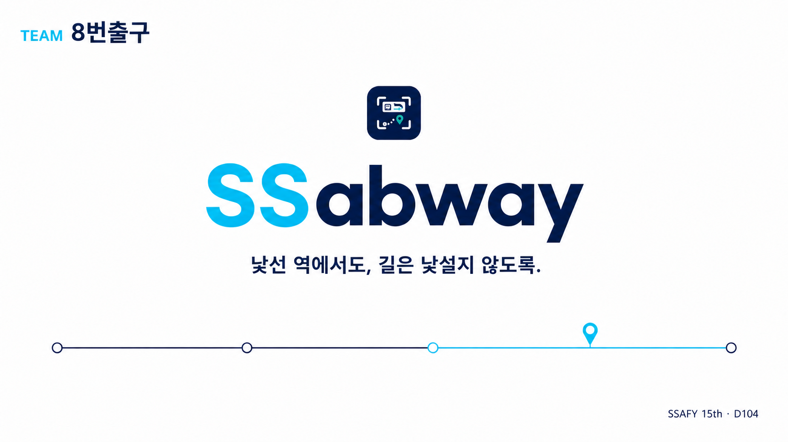
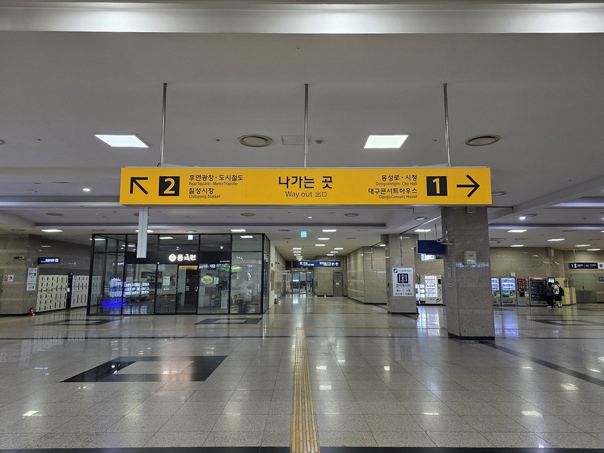
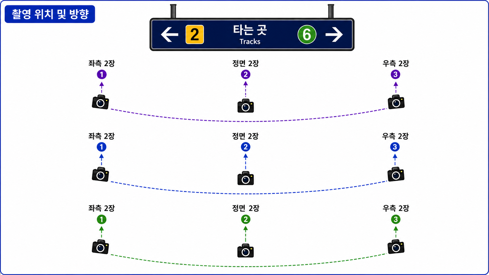

  

# SSabway · 강석진 포트폴리오

**외국인 여행객을 위한 지하철 실내 길안내·화상 상담 서비스**

SSAFY 15기 공통 프로젝트 · 팀 **8번출구** · 6명 · 2026.07–2026.08

> **담당: Backend / WebRTC** 
> 상담 요청부터 화상 연결·종료, 녹음 저장과 AI 요약까지 백엔드 흐름을 구현했습니다.

[서비스 소개](#서비스-소개) · [내 기여](#내-기여) · [현장 데이터셋](#현장-데이터셋-구축) · [트러블슈팅](#트러블슈팅) · [트레이드오프](#트레이드오프)

## 서비스 소개

GPS가 불안정한 지하철역에서 **표지판을 촬영해 현재 위치를 찾고, 다음 이동 방향을 안내**합니다. 도움이 필요하면 역무원과 화상으로 연결하며, 실시간 번역 자막으로 소통을 돕습니다.

| 위치 인식 | 실내 길안내 | 역무원 상담 |
| :---: | :---: | :---: |
| 표지판 검출·분류로 위치 추정 | 경유지를 포함한 최단 경로 안내 | 화상 연결·번역 자막·상담 요약 |

*표지판 인식, 경로 탐색, 번역 자막은 팀 전체의 서비스 기능입니다. 제 담당 구현은 아래와 같습니다.*

## 내 기여

| 담당 영역 | 직접 구현한 내용 |
| --- | --- |
| **상담 API** | 요청·상태·대기 순번 조회·수락·취소·시작·종료 API와 상태별 처리 |
| **화상 연결·인증** | OpenVidu 세션·참여 토큰 발급, WebRTC 서버의 JWT·상담 참여자 검증 |
| **상담 녹음** | 음성 녹음 시작·종료, 녹음 상태 웹훅, S3 업로드·DB 경로 저장 연동 |
| **AI 상담 요약** | GMS 호출·요약 프롬프트 작성, 상담 소유자·종료 상태 검증, 요약 저장 |

**사용한 기술:** Java 21 · Spring Boot · Spring Security · JPA · MySQL · OpenVidu · AWS S3 · GMS

담당 코드 살펴보기

- [상담 요청·수락](backend/ssabway/src/main/java/com/ssafy/ssabway/domain/consultation/service/ConsultationService.java)
- [OpenVidu 세션·토큰·녹음](backend/ssabway_webrtc/src/main/java/com/ssafy/ssabway_webrtc/domain/service/OpenViduService.java)
- [사용자 종료 처리](backend/ssabway_webrtc/src/main/java/com/ssafy/ssabway_webrtc/domain/service/ConsultationLeaveService.java)
- [녹음 저장 연동](backend/ssabway_webrtc/src/main/java/com/ssafy/ssabway_webrtc/domain/service/RecordingStorageService.java)
- [GMS 상담 요약](backend/ssabway/src/main/java/com/ssafy/ssabway/domain/consultation/service/ConsultationSummaryService.java)

현재 코드는 팀원의 후속 개선도 포함한 최종본입니다.

## 현장 데이터셋 구축

**팀원들과 직접 대구역을 조사하며 서비스에 필요한 표지판 사진과 실내 경로 데이터를 처음부터 구축했습니다.**

<table>
  <tr>
    <td align="center" width="50%"></td>
    <td align="center" width="50%"></td>
  </tr>
  <tr>
    <td align="center">대구역 현장 촬영</td>
    <td align="center">촬영 위치·방향 기준</td>
  </tr>
</table>

1. **현장 촬영:** 역사 안을 직접 이동하며 표지판과 주요 시설을 촬영했습니다. 좌측·정면·우측 방향과 거리, 사용자 키에 따른 촬영 높이를 달리해 실제 사용 환경을 반영했습니다.
2. **실내 지도 제작:** 현장에서 확인한 통로와 갈림길을 기준으로 대구역 내부 지도를 직접 그리고, 이동 가능한 경로를 노드와 엣지로 구조화했습니다.
3. **사진·지도 매핑:** 촬영한 표지판을 지도상의 위치와 방향에 연결해, AI가 표지판을 인식하면 해당 지점부터 길안내를 시작할 수 있도록 데이터셋을 구성했습니다.

  
   
  현장 조사 내용을 바탕으로 직접 제작하고 표지판 위치를 연결한 대구역 실내 지도

## 트러블슈팅

| 겪은 문제 | 내가 적용한 해결 |
| --- | --- |
| **사용자가 먼저 종료하면 상담이 정리되지 않음** | 사용자 종료용 `leave` API를 추가. 대기·매칭은 취소, 진행 중은 종료로 분기하고 종료된 상담의 재요청은 기존 상태를 반환하도록 구현 |
| **언어를 바꾸면 “해당 역에 역무원이 없음” 오류** | 표시용 역 이름 대신 `stationId`로 담당 역무원을 조회. 출발지·목적지 문구는 표시 정보로 유지해 언어와 식별자를 분리 |

## 트레이드오프

| 선택 | 얻은 점 | 감수한 점 |
| --- | --- | --- |
| **요청·수락은 메인 서버, 세션·토큰은 WebRTC 서버** | 상담 업무와 화상 연결의 책임을 구분 | 내부 인증·통신 실패 처리가 추가됨. DB 롤백과 외부 세션 정리는 별도로 다뤄야 함 |
| **자막 원문은 DB에 저장하지 않고 최종 요약만 저장** | 자막 저장량을 줄이고, 저장된 요약을 재사용 | 프론트의 자막이 유실되면 해당 자막으로 재요약하기 어려움. 음성 녹음은 S3에 별도 저장 |

## 회고

**상담이 연결되는 순간뿐 아니라, 누가 먼저 종료하고 요청이 다시 들어왔을 때도 설계해야 한다는 점을 배웠습니다.** 상태별 종료 경로를 정리하고 외부 API와 DB의 실패 범위를 구분하는 경험을 했습니다.

다음에는 **시작·종료 요청의 경합과 외부 API 실패를 재현하는 통합 테스트**, 창 닫기·네트워크 단절을 감지하는 서버 측 보완을 먼저 마련하고 싶습니다.

전체 아키텍처 · 팀 구성 · 문서

| Frontend | Backend | AI | Infra |
| --- | --- | --- | --- |
| 이송제·이윤우 | 황문규·**강석진** | 홍진규 | 김민준 |

- **팀 기술:** React · TypeScript · Spring Boot · MySQL · Redis · YOLO · ResNet18 · Azure Speech · Docker · Jenkins
- [WebRTC 백엔드](backend/ssabway_webrtc) / [메인 백엔드](backend/ssabway) / [프론트엔드](frontend) / [AI](ai)
- [설계 자료](docs) / [포팅 매뉴얼](exec/SSabway_포팅_매뉴얼.docx) / [환경변수 예제](.env.example)

