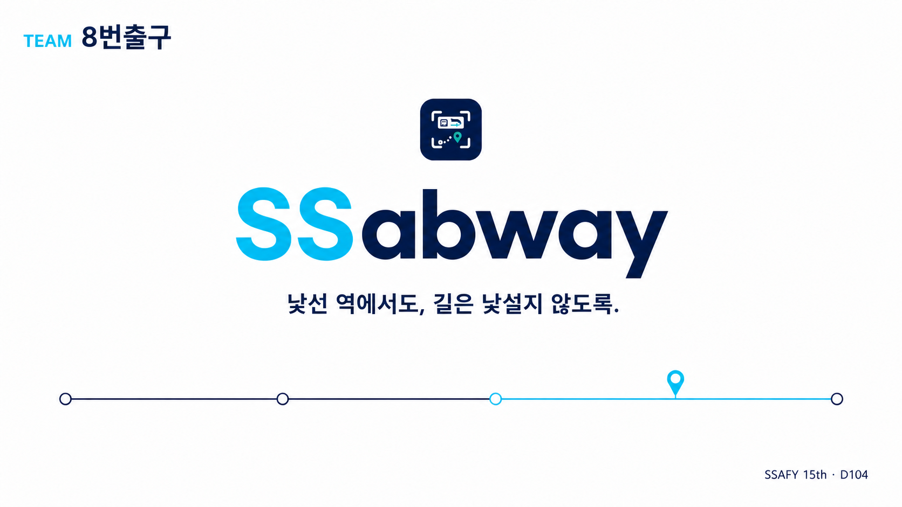
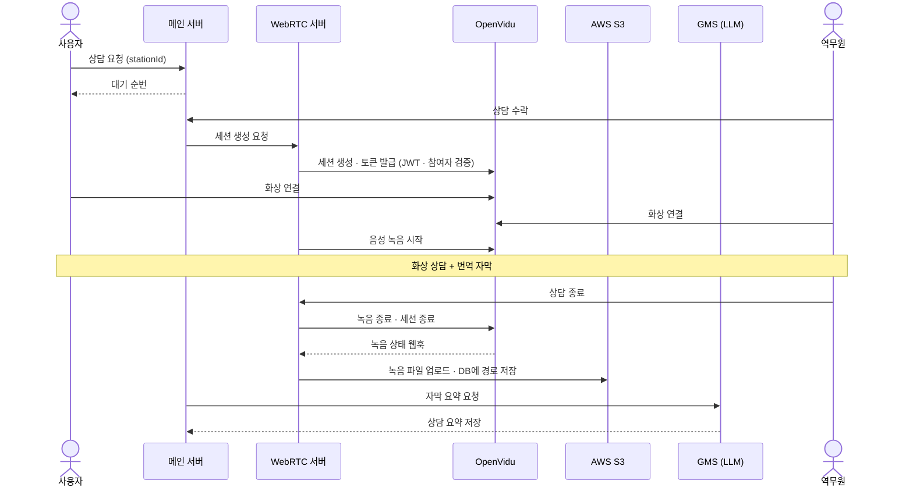
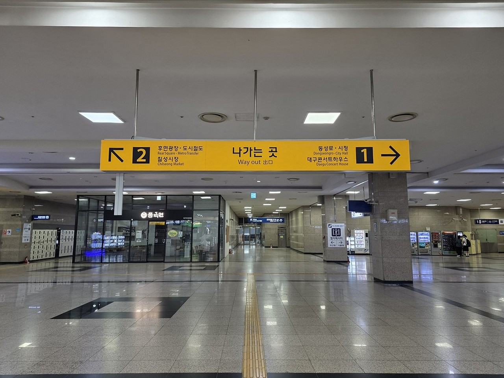
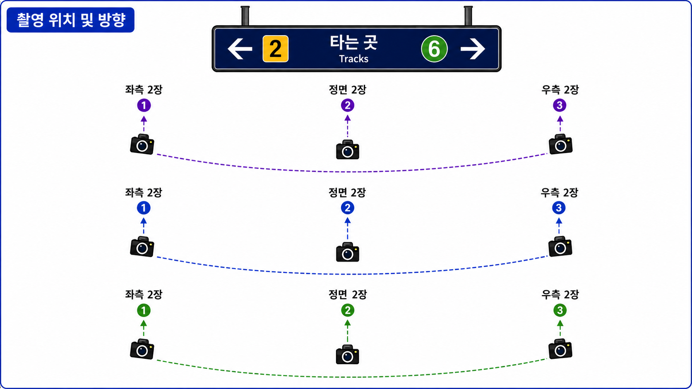

<p align="center">
  
</p>

<div align="center">
  <h1>🚇 SSabway</h1>
  <p><strong>외국인 여행객을 위한 지하철 실내 길안내 · 역무원 화상 상담 서비스</strong></p>

  <p>
    
    
    
    
    
    
    
    
  </p>

  <p>🏆 <strong>SSAFY 15기 공통 프로젝트 우수상</strong></p>

  <p>SSAFY 15기 공통 프로젝트 · 팀 <strong>8번출구</strong> · 6인 · 2026.07 ~ 2026.08<br>
  <strong>강석진 — Backend / WebRTC (화상 상담 · 녹음 · AI 요약)</strong></p>
</div>

<br>

> [!NOTE]
> SSAFY GitLab에서 팀으로 개발한 프로젝트를 커밋 이력과 함께 옮긴 저장소입니다.
> 표지판 인식 · 경로 탐색 · 번역 자막은 팀 전체의 기능이고, **이 README의 기여 · 트러블슈팅은 제가 맡은 상담 백엔드 영역**입니다.

<p align="center">
  <a href="#-서비스-소개">서비스 소개</a> ·
  <a href="#-담당-역할">담당 역할</a> ·
  <a href="#-트러블슈팅">트러블슈팅</a> ·
  <a href="#-상담-흐름">상담 흐름</a> ·
  <a href="#-현장-데이터셋-구축">현장 데이터셋</a> ·
  <a href="#-트레이드오프">트레이드오프</a> ·
  <a href="#-회고">회고</a>
</p>

<br>

## 🖥 서비스 소개

GPS가 잘 잡히지 않는 지하철역에서 **표지판을 촬영해 현재 위치를 찾고, 다음 이동 방향을 안내**합니다.
길을 잃으면 역무원과 **화상으로 연결**되고, 실시간 번역 자막으로 언어 장벽 없이 소통합니다.

| 📷 위치 인식 | 🧭 실내 길안내 | 🎥 역무원 화상 상담 |
| :---: | :---: | :---: |
| 표지판 검출 · 분류로 현재 위치 추정 | 경유지를 포함한 최단 경로 안내 | 화상 연결 · 번역 자막 · 상담 녹음 · AI 요약 |

<br>

## 🙋 담당 역할

메인 서버와 분리된 **WebRTC 서버**를 처음부터 세팅하고, 상담 요청부터 화상 연결 · 종료 · 녹음 저장 · AI 요약까지 상담 백엔드 전체 흐름을 구현했습니다.

| 영역 | 구현 내용 | 대표 커밋 |
| :-- | :-- | :-- |
| **상담 API** | 요청 · 상태 · 대기 순번 조회 · 수락 · 취소 · 시작 · 종료와 상태별 처리 | [`5bbdce6`](https://github.com/doljeen/SSAbway/commit/5bbdce699a661d959a7e7adea5328b344e644a9b) |
| **화상 연결 · 인증** | OpenVidu 세션 · 참여 토큰 발급, WebRTC 서버의 JWT · 상담 참여자 검증 | [`a167b47`](https://github.com/doljeen/SSAbway/commit/a167b47ecf39248270e153360c7ac7f20482c03d) |
| **상담 녹음** | 음성 녹음 시작 · 종료, 녹음 상태 웹훅, S3 업로드 · DB 경로 저장 | [`0dfdb8e`](https://github.com/doljeen/SSAbway/commit/0dfdb8ee972a5005b7f7e6d5a75f3293c086f6ff) |
| **AI 상담 요약** | GMS 호출 · 요약 프롬프트 작성, 소유자 · 종료 상태 검증, 요약 저장 | [`5ad9fd7`](https://github.com/doljeen/SSAbway/commit/5ad9fd7f6c8a81a9521d4940b161079179fe2c3e) |

<details>
<summary><b>담당 코드 바로가기</b></summary>

- [상담 요청 · 수락](backend/ssabway/src/main/java/com/ssafy/ssabway/domain/consultation/service/ConsultationService.java)
- [OpenVidu 세션 · 토큰 · 녹음](backend/ssabway_webrtc/src/main/java/com/ssafy/ssabway_webrtc/domain/service/OpenViduService.java)
- [사용자 종료 처리](backend/ssabway_webrtc/src/main/java/com/ssafy/ssabway_webrtc/domain/service/ConsultationLeaveService.java)
- [녹음 저장 연동](backend/ssabway_webrtc/src/main/java/com/ssafy/ssabway_webrtc/domain/service/RecordingStorageService.java)
- [GMS 상담 요약](backend/ssabway/src/main/java/com/ssafy/ssabway/domain/consultation/service/ConsultationSummaryService.java)

현재 코드는 팀원의 후속 개선까지 포함한 최종본입니다.

</details>

<br>

## 🔥 트러블슈팅

> 각 항목은 **문제 → 원인 → 해결 → 결과** 순서로 정리했습니다.

### 1. 상담 시작과 사용자 종료가 동시에 들어오면 상태가 꼬임

| | |
| :-- | :-- |
| **문제** | 역무원이 상담을 시작하는 순간 사용자가 종료를 누르면, 두 요청이 같은 상담을 동시에 읽고 각자 상태를 바꿔 **종료된 상담에 녹음이 시작되는 등 상태가 어긋날 수 있음** |
| **원인** | 시작 · 종료 서비스가 모두 `findById()`로 조회 후 상태를 변경 → 두 트랜잭션이 같은 이전 상태를 보고 진행 |
| **해결** | 상담 행을 `PESSIMISTIC_WRITE`(`SELECT ... FOR UPDATE`)로 잠가 조회하도록 시작 · 종료 · 사용자 종료 서비스를 변경 |
| **결과** | 같은 상담에 대한 시작 / 종료 요청이 **순서대로** 처리되고, 뒤에 온 요청은 바뀐 상태를 보고 분기 |

```java
@Lock(LockModeType.PESSIMISTIC_WRITE)
@Query("SELECT c FROM Consultation c WHERE c.id = :consultationId")
Optional<Consultation> findByIdForUpdate(@Param("consultationId") Long consultationId);
```

> [!WARNING]
> **후속 — 이 잠금이 새로운 문제를 만들었습니다.**
> 잠금을 잡은 트랜잭션 안에서 OpenVidu HTTP 호출을 3~4번 한 뒤에야 커밋했고, 그 사이 도착한 **녹음 완료 웹훅의 `record_s3` UPDATE가 같은 행 잠금에 막혀** 타임아웃으로 실패했습니다. OpenVidu는 웹훅을 재시도하지 않아 **S3에는 파일이 있는데 DB에는 경로가 없는** 상태가 생겼습니다. (운영 로그 기준 잠금 유지 460ms, 웹훅 도착은 세션 종료 650ms 뒤)
>
> 팀원(황문규)이 상태 전이만 짧은 트랜잭션으로 먼저 커밋하고 OpenVidu 정리는 잠금 밖에서 하도록 분리했고, 사용자 종료는 잠금 대신 **조건부 UPDATE**(상태가 맞을 때만 전이)로 바꿨습니다. → [`cd04d70`](https://github.com/doljeen/SSAbway/commit/cd04d70b08b032d6e69804a9d93f973ceeac61bd)
>
> **배운 점** — 잠금은 "무엇을 막는가"만큼 "**잠금 안에서 무엇을 하는가**"가 중요합니다. 외부 API 호출을 트랜잭션 · 잠금 안에 두면 다른 쓰기 경로(웹훅)를 막을 수 있습니다.

📎 [`3493363`](https://github.com/doljeen/SSAbway/commit/3493363be9f8d747cd411d2e86bfe8e98943c807)

---

### 2. 사용자가 먼저 나가면 상담이 정리되지 않음

| | |
| :-- | :-- |
| **문제** | 종료 API가 역무원 기준으로만 있어, 사용자가 먼저 나가면 상담이 대기 / 진행 상태로 남음 |
| **원인** | "누가 먼저 종료하는가"를 고려하지 않고 상담 상태 전이를 설계 |
| **해결** | 사용자용 `leave` API 추가. 상태별로 분기: **WAITING · MATCHED → 취소**, **IN_PROGRESS → 종료**, 이미 끝난 상담은 기존 상태를 그대로 반환(멱등) |
| **결과** | 어느 쪽이 먼저 나가도 상담이 정리되고, 중복 요청에도 에러 없이 같은 응답 |

```text
WAITING / MATCHED ──leave──▶ CANCELED   (MATCHED면 이미 만든 OpenVidu 세션도 종료)
IN_PROGRESS       ──leave──▶ ENDED      (녹음 · 세션 정리)
CANCELED / ENDED  ──leave──▶ 그대로     (중복 요청은 기존 상태 반환)
```

📎 [`5bbdce6`](https://github.com/doljeen/SSAbway/commit/5bbdce699a661d959a7e7adea5328b344e644a9b) · [`3493363`](https://github.com/doljeen/SSAbway/commit/3493363be9f8d747cd411d2e86bfe8e98943c807)

---

### 3. 수락 직후 취소하면 OpenVidu 세션이 남고, 남의 상담도 취소 가능

| | |
| :-- | :-- |
| **문제** | ① 역무원이 수락한 직후(MATCHED) 취소하면 DB만 취소되고 **OpenVidu 세션은 계속 살아 있음** ② 취소 API가 상담 ID만 받아 **다른 사용자의 상담도 취소 가능** |
| **원인** | 취소를 WAITING 상태만 전제로 구현 → MATCHED에서는 이미 세션이 만들어져 있다는 점을 놓침. 요청자 검증 없음 |
| **해결** | 인증 정보에서 요청자 ID를 꺼내 상담 소유자와 비교, MATCHED 상태 취소 시 DB 취소와 함께 **OpenVidu 세션 종료**. 외부 API 예외 시 롤백(`rollbackFor = Exception.class`) |
| **결과** | 본인 상담만 취소 가능, 취소된 상담에 화상 세션이 남지 않음 |

```diff
- public ConsultationCancelResponse cancelConsultation(Long consultationId) {
-     if (consultation.getStatus() != ConsultationStatus.WAITING) throw ...;
+ @Transactional(rollbackFor = Exception.class)
+ public ConsultationCancelResponse cancelConsultation(Long consultationId, Long requesterUserId) {
+     if (!consultation.getRequesterUserId().equals(requesterUserId))
+         throw new BusinessException(ErrorCode.CONSULTATION_ACCESS_DENIED);
+     if (status != WAITING && status != MATCHED) throw ...;
+     if (status == MATCHED) openViduService.closeSessionIfActive(SESSION_PREFIX + consultationId);
```

📎 [`f46d556`](https://github.com/doljeen/SSAbway/commit/f46d55648011e00f8a9001474b1065297c763f0e)

---

### 4. 1:1 상담 방에 제3자가 들어오거나, 재접속하면 연결이 중복됨

| | |
| :-- | :-- |
| **문제** | 세션 ID만 알면 누구나 토큰을 받아 들어올 수 있고, 새로고침 · 재접속 시 같은 사람의 연결이 중복으로 쌓임 |
| **원인** | 토큰 발급 시 기존 연결의 역할 · 참여자를 확인하지 않음 |
| **해결** | 연결 메타데이터에 역할(USER / STAFF)과 참여자 ID를 저장하고, 토큰 발급 시 ① 같은 역할의 **다른 사람이면 거부** ② **같은 사람이면 기존 연결을 끊고 재접속** 처리. 역할 값은 `USER`/`STAFF`만 허용. 추가로 WebRTC 서버에 JWT 인증 · 상담 참여자 검증 적용 |
| **결과** | 한 상담 방에는 사용자 1명 + 역무원 1명만 접속, 재접속해도 연결이 하나로 유지 |

📎 [`b625549`](https://github.com/doljeen/SSAbway/commit/b62554974bcc32a3f05a718b4614467a4ffa7d57) · [`a167b47`](https://github.com/doljeen/SSAbway/commit/a167b47ecf39248270e153360c7ac7f20482c03d)

---

### 5. 언어를 바꾸면 "해당 역에 역무원이 없음" 오류

| | |
| :-- | :-- |
| **문제** | 앱 언어를 영어 등으로 바꾸고 상담을 요청하면 담당 역무원을 찾지 못함 |
| **원인** | 담당 역무원을 **화면에 표시되는 역 이름**(`departure` 문자열)으로 조회 → 언어가 바뀌면 이름도 바뀌어 매칭 실패 |
| **해결** | 요청에 `departureStationId`를 추가하고 ID로 조회. 역 이름은 화면 표시용으로만 사용 |
| **결과** | 어떤 언어로 요청해도 같은 역무원에게 연결 |

```diff
- stationStaffRepository.findByDepartureStationName(request.departure().trim())
+ stationStaffRepository.findByStationId(request.departureStationId())
```

> **배운 점** — 표시용 값(이름)과 식별자(ID)를 섞으면 다국어처럼 표시만 바뀌는 상황에서 바로 깨집니다. 조회 키는 항상 변하지 않는 식별자로 해야 합니다.

📎 [`0d2d6c8`](https://github.com/doljeen/SSAbway/commit/0d2d6c8a6132385b4372080931605e184204de15)

---

### 그 밖의 이슈

| 증상 | 원인 | 해결 |
| :-- | :-- | :-- |
| 상담 종료 API를 아무나 호출할 수 있음 | 종료 엔드포인트에 역할 · 담당자 검증 없음 | `STAFF` 권한만 허용하고, 컨트롤러에서 해당 상담의 담당 역무원인지 추가 검증 ([`8fbecb3`](https://github.com/doljeen/SSAbway/commit/8fbecb3bc48a8e22aa95f6c8bedeb5d162d802ff)) |

<br>

## 🔄 상담 흐름



<br>

## 📍 현장 데이터셋 구축

**팀원들과 직접 대구역을 조사하며 서비스에 필요한 표지판 사진과 실내 경로 데이터를 처음부터 구축했습니다.**

<table>
  <tr>
    <td align="center" width="50%"></td>
    <td align="center" width="50%"></td>
  </tr>
  <tr>
    <td align="center">대구역 현장 촬영</td>
    <td align="center">촬영 위치 · 방향 기준</td>
  </tr>
</table>

1. **현장 촬영** — 역사 안을 직접 이동하며 표지판과 주요 시설을 촬영. 좌측 · 정면 · 우측 방향, 거리, 사용자 키에 따른 촬영 높이를 달리해 실제 사용 환경을 반영
2. **실내 지도 제작** — 현장에서 확인한 통로와 갈림길로 대구역 내부 지도를 직접 그리고, 이동 경로를 노드 · 엣지로 구조화
3. **사진 · 지도 매핑** — 촬영한 표지판을 지도상의 위치 · 방향에 연결해, AI가 표지판을 인식하면 그 지점부터 길안내를 시작하도록 구성

<p align="center">
  
  <br />
  <sub>현장 조사 내용을 바탕으로 직접 제작하고 표지판 위치를 연결한 대구역 실내 지도</sub>
</p>

<br>

## ⚖️ 트레이드오프

| 선택 | 얻은 점 | 감수한 점 |
| :-- | :-- | :-- |
| **요청 · 수락은 메인 서버, 세션 · 토큰은 WebRTC 서버** | 상담 업무와 화상 연결의 책임 분리 | 서버 간 인증 · 통신 실패 처리가 추가됨. DB 롤백과 외부 세션 정리를 따로 다뤄야 함 |
| **자막 원문은 저장하지 않고 최종 요약만 저장** | 저장량 감소, 저장된 요약 재사용 | 프론트의 자막이 유실되면 재요약 불가. 음성 녹음은 S3에 별도 보관 |

<br>

## 💭 회고

**잘한 점**
- 상담이 "연결되는 순간"만이 아니라 **누가 먼저 나가는지, 요청이 겹치는지, 다시 들어오는지**까지 상태별 경로를 설계했습니다.
- DB 상태와 외부 시스템(OpenVidu 세션, S3 녹음)의 정리 범위를 구분해 다뤘습니다.

**다음에 할 것**
- [ ] 시작 · 종료 요청 경합과 외부 API 실패를 재현하는 통합 테스트를 먼저 작성
- [ ] 창 닫기 · 네트워크 단절을 서버에서 감지해 상담을 정리하는 보완 (웹훅 · heartbeat)
- [ ] 트랜잭션 · 잠금 범위를 설계할 때 외부 API 호출과 웹훅 같은 다른 쓰기 경로를 함께 검토하기

<br>

## 🛠 기술 스택

| 구분 | 기술 |
| :-- | :-- |
| **내가 사용한 기술** | Java 21 · Spring Boot · Spring Security · JPA · MySQL · OpenVidu · AWS S3 · GMS |
| Frontend | React · TypeScript |
| Backend | Spring Boot · MySQL · Redis |
| AI | YOLO · ResNet18 · Azure Speech |
| Infra | Docker · Jenkins |

<details>
<summary><b>전체 아키텍처 · 팀 구성 · 문서</b></summary>


| Frontend | Backend | AI | Infra |
| :-- | :-- | :-- | :-- |
| 이송제 · 이윤우 | 황문규 · **강석진** | 홍진규 | 김민준 |

- [WebRTC 백엔드](backend/ssabway_webrtc) · [메인 백엔드](backend/ssabway) · [프론트엔드](frontend) · [AI](ai)
- [설계 자료](docs) · [포팅 매뉴얼](exec/SSabway_포팅_매뉴얼.docx) · [환경변수 예제](.env.example)

</details>

<br>

<sub>원본은 SSAFY GitLab 프로젝트이며, GitHub로 옮기며 이력을 정리해 커밋 SHA가 원본과 다릅니다. CI 설정(`.gitlab-ci.yml`, `Jenkinsfile`)은 개발 당시 기록으로, 이 저장소에서는 동작하지 않습니다.</sub>
